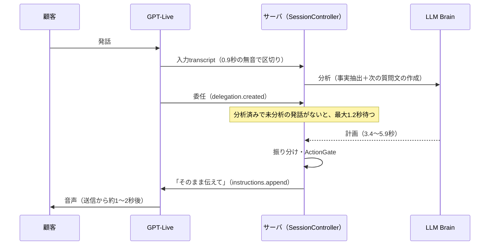
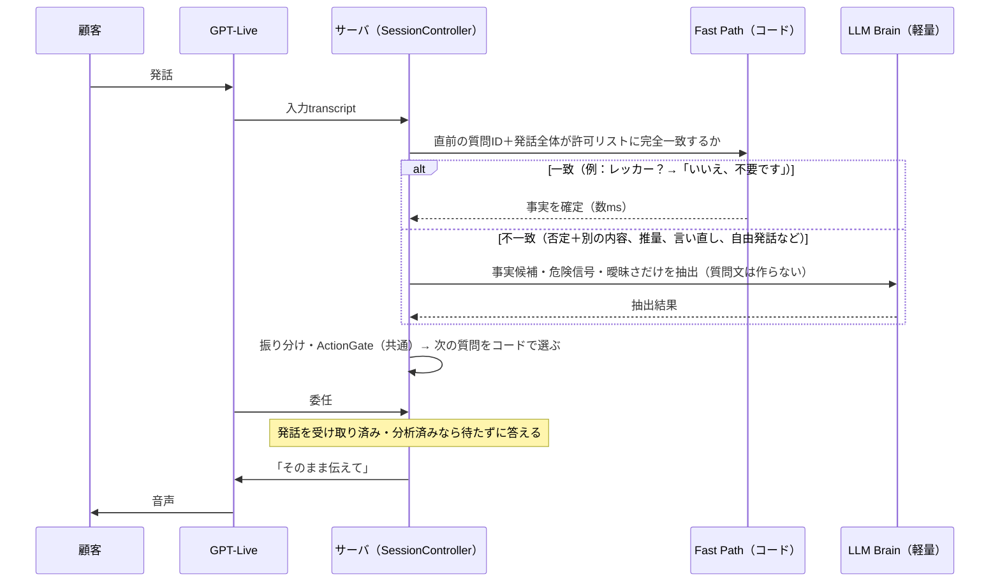

# 応答遅延改善：実装・検証報告（2026-11-06）

対象：作業指示書「STS事故受付モック｜音声AIの応答遅延改善」。決定記録は [decisions.md](decisions.md) の D16〜D19。

## 要約

- 改善前（A）・軽量化（B）・Hybrid（C）の3構成を実装した。画面の「応答速度の構成」で通話ごとに切り替えられ、環境変数 `LATENCY_PROFILE=baseline` で改善前に戻せる。
- 既存の受入テストは、Deterministic Brainで A/B/C とも 39ケース×3回＝117/117 合格。追加した33ケースでは、Fast Pathの誤判定は0件だった。
- **LLM Brainと実機音声での応答時間・正答率は未計測**。この作業環境にはAPIキーがないため。計測の仕組み（ターン単位の記録、画面の比較ベンチ）は実装済みで、Renderで実行すれば数値が出る。
- 目標（P50 2.5秒・P95 4.0秒）の到達見込み（**要検証**）：
  - Fast Pathで処理するターン：約2.7秒と推定。
  - LLMを使うターン：Brainの時間がそのまま残るため、4秒を超える見込み。
  - P95 4.0秒の達成は、軽量プロンプトでBrainがどこまで速くなるか次第。

## (１) 変更概要

| ファイル | 内容 |
|---|---|
| `server/src/session/latency.ts`（新規） | プロファイル定義（A/B/C）、ターン計測の型、区間の計算、P50/P95 集計 |
| `server/src/domain/questions.ts`（新規） | 質問文と、次の質問をコードで選ぶ処理（D16） |
| `server/src/brain/fastPath.ts`（新規） | Fast Path：質問IDと許可リストの完全一致で、定型の回答を確定する（D17） |
| `server/src/brain/openaiBrain.ts` | 軽量モード（抽出専念の指示・出力項目の削減・直近12発話・プロンプトキャッシュキー）、推論量の上書き、トークン数と推定費用の記録。従来モードの指示文は一字一句同じ |
| `server/src/brain/pricing.ts`（新規） | 公式ページの単価と、対応する推論量 |
| `server/src/session/controller.ts` | プロファイル、Fast Pathの組み込み（同じ applyPlan と ActionGate を通る）、質問IDの記録、ターン計測、Shadow評価、評価用ヘルパ |
| `server/src/live/liveAdapter.ts` | 計測点（発話終了・委任・送信・音声開始）、委任時の待機削減（D18）、名乗りの質問IDの記録 |
| `client/src/live.ts`, `client/src/App.tsx` | 構成の選択、ブラウザ側の再生開始の計測、ターン別の応答時間表示、A/B/C比較ベンチの画面 |
| `server/src/eval/turnBench.ts`, `benchCli.ts`（新規） | 1ターン比較ベンチ（33ケース）。`npm run bench` |
| テスト | `fastPath.test.ts`、`liveAdapter.test.ts`（sidebandの模擬）、受入テストを A/B/C の3構成で実行 |

## (２) 処理フロー

### 改善前（A）

### 改善後（C：Hybrid）

## (３) 性能比較

未計測の値は推定で埋めていない。

| 指標 | 改善前A | 軽量化B | Hybrid C |
|---|---|---|---|
| 応答時間 P50（実機音声） | 未計測（参考：既存ログの実測は6〜8秒） | 未計測 | 未計測 |
| 応答時間 P95（実機音声） | 未計測 | 未計測 | 未計測 |
| Brain処理時間（LLM） | 未計測（参考：既存ログ3.4〜5.9秒） | 未計測 | 未計測（Fast Pathのターンは0〜1ms） |
| Fast Path適用率（33ケース） | 0% | 0% | 39%（13/33。対象外にすべき20件はすべてLLMへ回った） |
| Fast Path適用率（典型的な通話の模擬、12ターン） | 0% | 0% | 42%（5/12） |
| 受入テスト（Deterministic、39ケース×3回） | 117/117 | 117/117 | 117/117 |
| 受入テスト（LLM Brain） | 未実施 | 未実施 | 未実施 |
| 1ターン比較ベンチの正確性（Deterministic） | 85% | 85% | 88% |
| 推定API費用 | 算出不可（トークン数が未計測。単価は luna 入力$0.10・出力$0.50／terra 入力$1.00・出力$5.00、いずれも100万トークンあたり） | 同左 | 同左。Fast Pathのターンは0 |

1ターン比較ベンチの安全上の失敗2件（F14「レッカーは不要ですが、足を打っています」、F18「いえ、あ、やっぱり必要です」）について：

- どちらもDeterministic Brainのキーワード規則の限界で、A/B/Cとも同じ結果だった。
- どちらもFast Pathには入らず、LLMへ回る（設計どおり）。
- LLM Brainで正しく判定できるかは、実機で確認する必要がある（**要検証**）。

### 推定の根拠（要検証）

既存ログ（CONV-2592e797、terra）の時刻から読み取った値：

- 発話終了から委任まで：約1.6秒
- 送信から音声開始まで：約1.1秒
- つなぎ言葉の後ろに並んだ待ち：約1.06秒

これらを使った推定：

- Fast Pathのターン：委任までの約1.6秒＋送信後の約1.1秒で、約2.7秒。
- LLMのターン：これに軽量Brainの時間が加わる。

なお、発話終了と委任の時刻はセッション開始時刻からの換算を含む。

## (４) 品質・安全性

- 既存テスト：vitest 186件すべて合格。型検査とlintも合格。受入テストはA/B/C×39ケース×3回で全合格。
- 追加テスト：
  - Fast Path：許可リスト外の発話はLLMへ回すこと、質問IDがない場合と同意（確認読み上げへの返事）は扱わないこと、二重処理がないこと、Shadow評価が状態を書き換えないこと。
  - Live模擬：
    - 委任に待たずに答えること、改善前は1.2秒待つこと（改善前を再現できる）。
    - 委任が先に届いた場合は待つこと。
    - AIの音声開始前の割り込み。
    - 確認読み上げの途中で「はい」と割り込んでも同意にしないこと。
    - つなぎ言葉と質問が重ならないこと。
- 実装中に見つけて直した不具合：Live通話では名乗り（レッカーの質問）の質問IDが記録されず、最初の回答でFast Pathが効かなかった。Live模擬テストで見つけて修正した。
- 維持したこと：
  - 「バックエンドが指定した文をGPT-Liveがそのまま話す」設計（D14）、つなぎ言葉（D15）。
  - 同意は明確な発話でのみ取る。読み上げ確認の判定、ActionGate、冪等キー、OUTCOME_UNKNOWNを自動再送しないことも従来どおり。

## (５) 残る課題と次の対策

1. **LLM・実機での計測が未実施（最優先）**
   - (１) 画面「受入テスト」タブの「応答速度の比較」で、LLM Brainを選び A/B/C を実行する（33ケース×3構成＝最大99回のAPI呼び出し。luna なら費用は小さい見込み）。
   - (２) 推論量 none / low の比較も同じ画面で行う。
   - (３) 受入テスト（T01〜T39）をLLM Brain×Hybridで1回実行する（39回、上限40回の範囲内）。
   - (４) 実機で通話し、「応答時間」欄のサーバ計測と耳で聞こえるまでの値のP50/P95を見る。
2. **GPT-Live側の区切り検知（発話終了→委任 約1.6秒）**：公式ドキュメントに区切り検知の設定項目は見当たらない（2026-11-06確認）。Fast Pathのターンでは、ここが残る待ち時間の大半になる。
3. **送信から音声開始まで（約1〜2秒）**：GPT-Live側の生成時間で、アプリからは短縮できない。
4. **つなぎ言葉の後ろに並ぶ待ち（最大約1秒）**：LLMのターンだけで起きる。テラで声が変わった件もつなぎ言葉の経路が候補なので、両方をまとめて見直す（要検証）。
5. **Fast Mode（`service_tier: priority`）**：公式ページでは最大2.5倍速く、料金は2倍。費用が増えるため実装していない。採用する場合はTakaさんの判断が必要。

### Phase 3：GPT-Liveに直接事実を抽出させる方式（設計案のみ・未実装）

| 案 | 内容 | 期待 | 懸念 |
|---|---|---|---|
| P3-a Responses委任＋関数ツール | `delegation.type: 'responses'` にし、Live管理のResponsesモデルに `record_facts`（事実候補だけを返す関数）を持たせる。関数の実行はアプリ（SessionController/ActionGate）が行い、出力として次の質問を返す | 別LLM Brainへの往復が1段減る | 関数呼び出し自体の遅延、Live側モデルの抽出精度、指示の保守場所が2つに分かれる |
| P3-b Decisionsトリガー | `session.input_transcript.delta` に Decisions の質問（「直前の質問への回答は はい/いいえ/その他」など）を設定し、Fast Pathの判定を補う | 許可リストより柔軟な短答判定 | Decisions APIの精度・遅延・費用が不明 |
| 現行（C） | 別LLM Brain＋Fast Path | 責任分界が明確 | LLMのターンはBrain時間が残る |

いずれの案でも、受付可否・登録権限はGPT-Liveに渡さず、最終判定は既存コード（decideRoute/ActionGate）が行う。

比較計画：

- 同じ33ケースと受入39ケースを、テキスト入力ではなく合成音声の固定音源で流し、次を比べる。
  - 区切り検知
  - ツール呼び出し（または委任）から結果受信までの時間
  - 事実抽出の正確性
  - 有人転送の見逃し件数
  - 保守性（指示の置き場所の数）
- 採用条件：
  - 安全上の失敗が0件であること。
  - 現行Cより応答時間のP50/P95が改善すること。
- 撤退条件：抽出精度が現行Cを下回ること。

## (６) 設定方法・戻し方

| 環境変数 | 既定 | 説明 |
|---|---|---|
| `LATENCY_PROFILE` | `hybrid` | `baseline`（A：改善前）／`lightweight`（B）／`hybrid`（C）。画面で通話ごとに上書きできる |
| `BRAIN_REASONING_EFFORT` | `low` | luna/terraは none, low, medium, high, xhigh, max に対応（minimalは記載なし） |
| `FASTPATH_SHADOW` | 未設定（オフ） | `1` でShadow評価をオンにする（API費用が発生） |
| `BENCH_MAX_LLM_CALLS` | 120 | 画面の比較ベンチのLLM呼び出し上限 |

- 改善前に戻す方法は2つある：
  - Renderの Environment で `LATENCY_PROFILE=baseline` を設定する。
  - 画面の「応答速度の構成」で「A：改善前」を選ぶ。
- CLIでの実行：
  - `npm run eval -- --profile hybrid`
  - `npm run bench -- --brain llm --profiles baseline,hybrid --efforts none,low`
